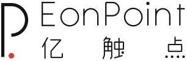
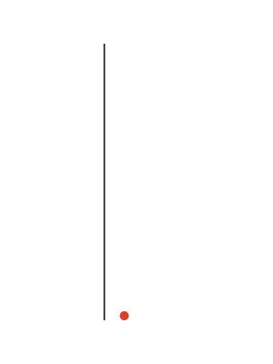

# danlogo-leicastyle · Leica Style

English · [中文](README.zh-CN.md)

> The sound of a shutter: short, exact, light, and then quiet.

The Leica Style direction of the danlogo series: a logo and brand-identity design skill for AI tools. It bundles a design style, a nine-stage working method and a set of drawing tools. The style draws on the design thinking behind Leica's products and logo, the functionalism of the Ulm School and Braun, the system identities of Otl Aicher and Anton Stankowski, the tradition of makers' marks, and Mies and concrete art. It was distilled from the EonPoint 亿触点 scheme C "Kū (Emptiness)". It works with Claude (Claude Code, desktop, claude.ai), Codex, and any tool that reads the [Agent Skills](https://agentskills.io) format.

> Leica is a trademark of Leica Camera AG. This project only draws on the design thinking behind Leica's products and is not affiliated with Leica Camera AG.

It fixes **character and quality**, not shapes, colours or techniques: every new brand grows its own form from its own name.

## The style

**Not tied to any industry**: choose it for the aesthetic. The industry only changes where the motif comes from.

**Locked formal language**: one abstract body, either a single stroke of even width or one solid plane, built only from straight lines and arcs of one (at most two) radii, plus one signature. Neutral body, colour only for the signature.

**Core relation: a precise body plus one signature.** The calibrated, essential body carries recognition and is the lead. A single signature with human warmth says who made it and plays the supporting role. Warmth lives only in the signature; the body always looks precision-made. Remove the signature and the body is still recognisable.

| Gene | In one line |
|---|---|
| Only the essential | Every element has a job; delete until one more deletion would break it |
| One piece | One complete outline with almost no seams, as if made from one block |
| Calibrated | Sizes come from a readable proportion and a clear datum; lines and one or two arc radii only |
| One signature | One place with warmth: a directed ending, an asymmetry, a colour, a cut, a texture |
| Calm and neutral | The body is neutral; colour is a signal reserved for the signature |
| Precision and tolerance | One line weight, radius and gap throughout; a dedicated small-size version |
| Can be made | Still holds when engraved, pressed or cut, without colour |
| Quiet and lasting | No fashionable effects; it should hold for decades |
| Abstract, element first | A precise abstract form, never a picture of an object |

**Element first, letter second.** The body may also read as the brand's initial, provided it is *constructed* from lines and arcs by proportion and datum rather than *written*. If you remove the signature and the one precise stop or opening, what remains must not be the standard way of writing that letter. Drawing an animal, plant, object, building, landscape, person or product is ruled out: that produces an icon-set pictogram.

It sits between two failures. Precision with no signature looks like any engineering firm. A signature with no precision becomes a casual flourish.

## Case: EonPoint 亿触点 scheme C "Kū"

Borrow the method, not the form. The shapes, colours and lettering of the case answer that brand's brief; they are not rules of the style. The case materials are **not** covered by the MIT License (see [License](#license)).

  

## Nine stages

1. Brief
2. Concepts: first a shortlist of 9 minimal sketches on one sheet for you to pick from, then 5 concept cards
3. Prototypes (at least 3 per concept, each with a signature-removed version), always rendered next to the case mark as a yardstick
4. Mark refinement
5. Final type and colour
6. System
7. Scenes
8. Proposal
9. Wrap-up: the AI asks whether to fold the project back into the skill

Every stage ends with your explicit confirmation.

## What's inside

```
SKILL.md                     Entry point: scope, three layers of rules, nine stages
references/
  philosophy.md              Style chapter 1: lineage and ideas
  exemplars.md               Appendix: reference works and how to use them without copying
  style-dna.md               Style chapter 2: genes, coordinates, knobs, touchstones
  creative-methods.md        Style chapter 3: motifs, the 9-sketch shortlist, concept cards
  style-extension.md         Style chapter 4: system, scenes and proposal aesthetics
  workflow.md · quality-gates.md · craft.md · deliverables.md · feedback-playbook.md
                             Shared danlogo-core chapters
cases/eonpoint-precision/    The case (not MIT-licensed)
examples/eonpoint-precision/ The case's source code (not MIT-licensed)
scripts/prim.py              One-stroke pen with true arcs, whole primitives, and a part/radius report
scripts/                     geom.py, sheet.py, render.sh, review.py and more
adapters/                    Claude vs Codex differences
agents/openai.yaml           Codex display metadata
evals/                       Test briefs and test records
PROMPT-CARD.md               Style prompt card: paste into any AI when the skill isn't installed
install.sh                   Install, update, package
```

## Install

```bash
git clone https://github.com/dan-cube/danlogo-leicastyle.git
cd danlogo-leicastyle
./install.sh            # installs for Claude Code (~/.claude/skills) and Codex (~/.agents/skills)
```

- One target only: `./install.sh claude` or `./install.sh codex` (restart Codex afterwards).
- claude.ai: run `./install.sh package`, or download `danlogo-leicastyle.skill` from Releases, and upload it in claude.ai's skill settings.

## Use

Just ask, for example: "Design a logo for my coffee roastery in the Leica Style." In Codex you can call it explicitly with `$danlogo-leicastyle`.

## Update

- `git pull && ./install.sh` updates your local install.
- At stage 9 the AI asks whether to fold the project into the skill; nothing is written without your approval, and `VERSION` and `CHANGELOG.md` are updated with it.
- The five `danlogo-core` chapters in `references/` are maintained by the danlogo series standard, not edited per skill.

## License

The skill's own text and code are released under the [MIT License](LICENSE).

**The EonPoint 亿触点 case is excluded.** Everything under `cases/eonpoint-precision/` and `examples/eonpoint-precision/`, and any image of the EonPoint marks, wordmarks, palettes or applications elsewhere in this repository, is © 2026 dan-cube, all rights reserved. It is published only so the method can be studied. Don't use, copy, modify, adapt or redistribute it, or use it as a logo or brand identity, without written permission. The EonPoint 亿触点 name belongs to its owner.
