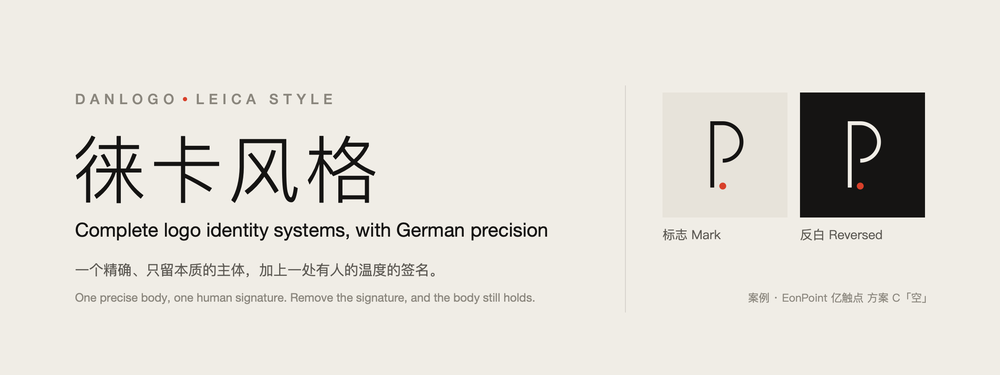
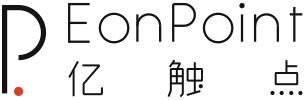
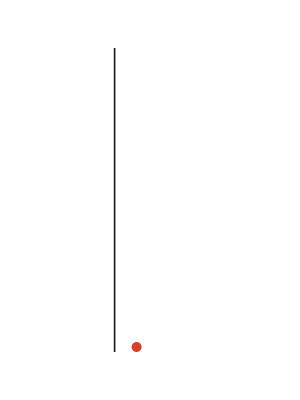

# danlogo-leicastyle · 徕卡风格

[English](README.md) · 中文



> 快门落下的那一声：短、准、轻，然后安静。

danlogo 系列的徕卡风格方向：一个给 AI 用的 logo / 品牌标志设计 skill。它包含一种设计风格、一套九阶段工作方法和一组绘图工具。风格的思想来自徕卡的产品与标志、乌尔姆设计学院与博朗的功能主义、艾舍与斯坦科夫斯基的系统识别、制造者印记的传统，以及密斯与具体艺术。沉淀自 EonPoint 亿触点的方案 C「空」，适用于 Claude（Claude Code、桌面版、claude.ai）与 Codex，以及其他支持 [Agent Skills](https://agentskills.io) 格式的工具。

> 徕卡（Leica）是 Leica Camera AG 的商标。本项目只借鉴其产品背后的设计思想，与该公司无关。

它规定**气质和质量**，不规定形状、颜色或工艺：每个新品牌都从自己的名字里长出新的形。

## 风格

**不限行业**：按审美来选它。行业只改变母题从哪里来。

**锁定的造型语言**：一个抽象的主体——一笔等宽的线，或一块实的面——只由直线和一种（最多两种）半径的圆弧组成，加上一处签名。主体中性，颜色只给签名。

**核心构成：精确的主体 + 一处签名。** 校准过、只留本质的主体承担识别，是主角；一处有人的温度的签名说出「这是谁做的」，是配角。温度只放在签名那一处，主体始终像被精密制造出来的；签名摘掉，主体依然认得出。

| 基因 | 一句话 |
|---|---|
| 只留本质 | 每个元素都说得出功能，删到再删就不成立 |
| 一体 | 完整的外轮廓、极少的接缝，像一整块材料做出来的 |
| 校准 | 尺寸来自看得懂的比例和明确的基准；只用直线和一两种半径的弧 |
| 一处签名 | 只有一处温度：有方向的收尾、不对称、颜色、切口或质地 |
| 冷静的中性 | 主体中性，颜色像信号一样只给签名 |
| 精度与公差 | 线宽、圆角、间隙全图统一；有专门的小尺寸版 |
| 可以被制造 | 刻、压、切在材料上，没有颜色也成立 |
| 安静与经久 | 不靠流行手法，几十年后仍成立 |
| 抽象，元素先于字 | 一个精确的抽象形，而不是一样东西的图 |

**元素先于字。** 主体可以同时读出品牌名的首字母，条件是它由直线和弧按比例与基准**构造**出来，而不是**写**出来：去掉签名和那一处精确的停顿或开口，剩下的不应该还是这个字母的标准写法。不画动物、植物、器物、建筑、风景、人和产品——那会变成图标库里的象形图。

它站在两种失败之间：只有精确、没有签名，就和任何一家工程公司没有区别；只有签名、没有精确，就成了随手的花样。

## 案例：EonPoint 亿触点方案 C「空」

只借方法，不借形式：案例里的形、颜色和字都是那个品牌的答案，不是本风格的规定。案例材料**不在 MIT 许可范围内**（见[许可](#许可)）。

  

## 九个阶段

1 简报 → 2 概念（先出一张 9 张极简速写的海选图给你挑，再写 5 张概念卡）→ 3 原型（每个概念 ≥3 套，附摘签名版，始终和案例标志并排看）→ 4 图形精修 → 5 定稿（定制字 + 配色）→ 6 体系 → 7 场景 → 8 提案 → 9 总结（AI 询问是否把项目沉淀进 skill）

每个阶段都等你明确确认。

## 里面有什么

```
SKILL.md                     入口：定位、三层要求、九个阶段、贯穿规则
references/
  philosophy.md              风格章 1：思想坐标
  exemplars.md               风格章 1 附录：参照作品与示范用法
  style-dna.md               风格章 2：风格基因、风格坐标、旋钮、试金石
  creative-methods.md        风格章 3：母题、9 张海选、概念卡、防同质化
  style-extension.md         风格章 4：体系、场景、提案的审美
  workflow.md · quality-gates.md · craft.md · deliverables.md · feedback-playbook.md
                             danlogo 系列共用章节
cases/eonpoint-precision/    案例（不在 MIT 许可内）
examples/eonpoint-precision/ 案例的生成代码（不在 MIT 许可内）
scripts/prim.py              一笔画（真正的圆弧）、整件的基本形、件数与半径报告
scripts/                     geom.py、sheet.py、render.sh、review.py 等通用工具
adapters/                    Claude 与 Codex 的使用差异
agents/openai.yaml           Codex 的显示信息
evals/                       测试简报与测试记录
PROMPT-CARD.md               风格提示词卡：没装 skill 时贴给任何 AI
install.sh                   安装 / 更新 / 打包
```

## 安装

```bash
git clone https://github.com/dan-cube/danlogo-leicastyle.git
cd danlogo-leicastyle
./install.sh            # 同时装到 Claude Code（~/.claude/skills）和 Codex（~/.agents/skills）
```

- 只装一个：`./install.sh claude` 或 `./install.sh codex`（Codex 需重启后生效）。
- claude.ai：运行 `./install.sh package`，或在 Releases 下载 `danlogo-leicastyle.skill`，上传到 claude.ai 的技能设置里。

## 使用

直接说需求，例如：“用徕卡风格，给我的咖啡烘焙品牌做一个 logo。”在 Codex 里可以用 `$danlogo-leicastyle` 显式调用。

## 更新

- `git pull && ./install.sh` 更新本机安装。
- 第 9 阶段 AI 会询问是否把这个项目沉淀进来；你批准后才写入，并更新 `VERSION` 与 `CHANGELOG.md`。
- `references/` 中标有 `danlogo-core` 的五个共用章节由 danlogo 系列标准统一维护，不在单个 skill 里单独改。

## 许可

本 skill 自己的文字和代码采用 [MIT 许可](LICENSE)。

**EonPoint 亿触点案例除外。** `cases/eonpoint-precision/` 与 `examples/eonpoint-precision/` 下的全部内容，以及本仓库其他位置出现的 EonPoint 标志、字标、配色与应用的图片，设计版权归 dan-cube 所有，保留一切权利。它们只为学习方法而公开；未经书面许可，不得使用、复制、修改、改编、再分发，也不得用作标志或品牌形象。EonPoint 亿触点的名称归其所有者所有。
